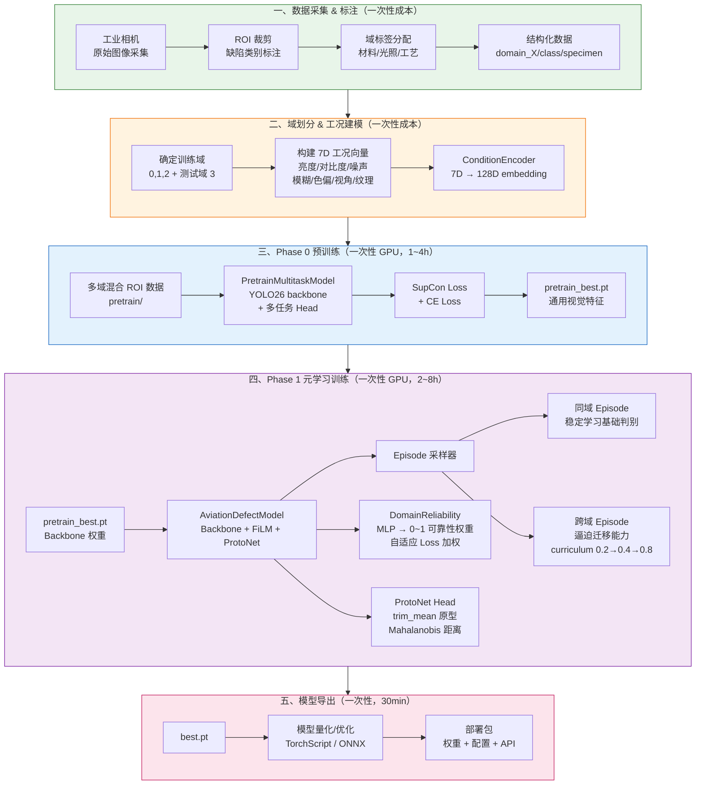
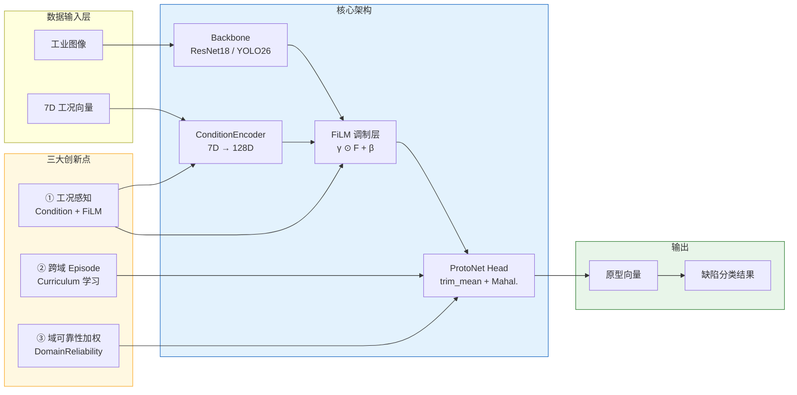

# CA-IS-MetaProto 架构图（Mermaid 源文件）

> 可复制粘贴到 https://mermaid.live 或 Markdown 渲染器中查看

---

## 图1：训练阶段完整架构



---

## 图2：部署推理阶段完整架构

```mermaid
flowchart TB
    subgraph init["一、新缺陷上线（5 张样本 + 工况输入）"]
        F1[new 缺陷样本<br/>5 张标注图像]
        F2[7D 工况向量输入<br/>当前产线参数]
        F3["Support Set<br/>5 张 × N 类 → 原型"]
    end

    subgraph deploy["二、Few-Shot 适配（~10 秒，无 GPU 需求）"]
        G1[加载 best.pt<br/>本地推理引擎]
        G2["输入 Support 图像<br/>→ Backbone + FiLM]
        G3["trim_mean 原型构建<br/>同类样本平均（去极值）"]
        G4["原型存储<br/>in-memory"]
    end

    subgraph infer["三、本地推理（工业现场实时）"]
        H1[Query 图像输入<br/>工业相机实时采集]
        H2["Backbone + FiLM<br/>提取 Query 特征"]
        H3["计算 Mahalanobis 距离<br/>到各类原型"]
        H4["分类结果输出<br/>缺陷类别 + 置信度"]
        H5[触发后续动作<br/>分拣/复检/报警]
    end

    subgraph expand["四、持续扩展（按需）"]
        I1[新产线/新产品上线]
        I2[提供新 5 张样本]
        I3[更新 Support Set<br/>原型自动刷新]
        I4[无需重新训练<br/>无需 GPU]
    end

    subgraph superiority["vs. 传统方案对比"]
        J1[传统方案<br/>每换缺陷需重训<br/>大量同分布样本<br/>GPU 持续消耗]
        J2[CA-IS-MetaProto<br/>5 张即上线<br/>单卡 8GB 本地推理<br/>数据不出厂]

        style J1 fill:#ffebee,stroke:#c62828
        style J2 fill:#e8f5e9,stroke:#2e7d32
    end

    F1 --> F3
    F2 --> G2
    F3 --> G4

    F1 --> G2
    G1 --> G2
    G2 --> G3 --> G4

    G4 --> H1
    H1 --> H2 --> H3 --> H4 --> H5

    H5 --> I1
    I1 --> I2 --> I3 --> G4

    style F1 fill:#e8f5e9,stroke:#2e7d32
    style F2 fill:#fff3e0,stroke:#ef6c00
    style F3 fill:#e8f5e9,stroke:#2e7d32
    style deploy fill:#e3f2fd,stroke:#1565c0
    style infer fill:#f3e5f5,stroke:#7b1fa2
    style expand fill:#fff8e1,stroke:#f9a825
```

---

## 图3：训练阶段关键创新点串联（简化版）



---

*文件版本：v1.0 | 生成日期：2026-09-12 | 可在 https://mermaid.live 预览*
