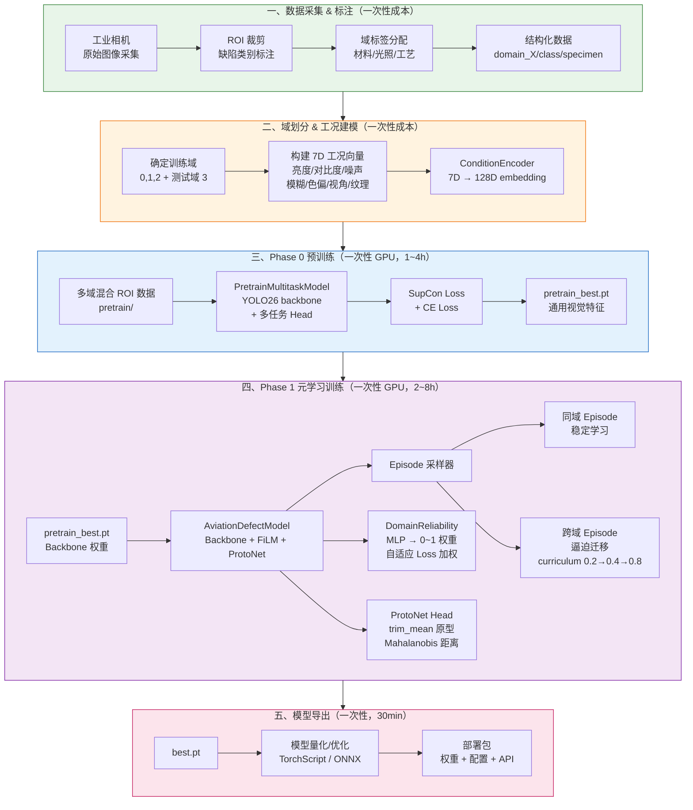
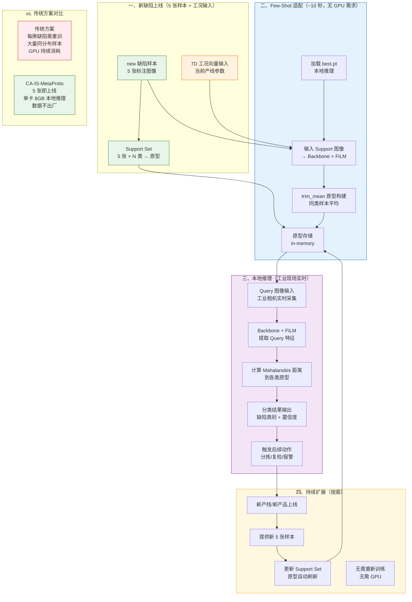

# CA-IS-MetaProto 完整工作流：从训练到部署

> 本文档配合 `工业视觉.pptx` 使用，补充说明 **训练阶段从 0 到 1 的成本** 与完整工作流，
> 并通过两张架构图分别展示训练阶段与部署推理阶段。

---

## 一、训练阶段：从 0 到 1 的完整路径

### 1.1 成本总览

| 阶段 | 内容 | 耗时 | 所需资源 | 重复次数 |
|------|------|------|----------|---------|
| **数据采集** | 工业相机拍摄原始图像 + ROI 裁剪 + 缺陷标注 | **1~2 周** | 工业相机 + 标注人员 | 每条产线 **1 次** |
| **域划分** | 确定 train/test 域 + 构建 7D 工况向量 | **2~3 天** | 算法工程师 | 每条产线 **1 次** |
| **Phase 0 预训练** | 多任务预训练 backbone（SupCon + CE） | **1~4 小时** | 单卡 GPU（8 GB+） | 每条产线 **1 次** |
| **Phase 1 元学习** | 跨域 Episode + DomainReliability + ProtoNet | **2~8 小时** | 单卡 GPU（8 GB+） | 每条产线 **1 次** |
| **模型导出** | 量化 + 部署包生成 | **30 分钟** | CPU 即可 | 每条产线 **1 次** |
| **部署推理** | 5-shot 适配 + 本地推理 | **~10 秒/次** | **单卡 8 GB / 边缘设备** | **按需，每次几分钟** |

> **核心结论**：训练阶段是一次性成本（一次性 GPU 使用 + 人工标注），后续每换一条产线/新缺陷，
> 仅需提供 5 张标注样本 + 工况参数，无需 GPU，无需重新训练。

---

### 1.2 各阶段详细说明

#### 阶段 0：数据采集与标注（一次性）

```
产线现场
  └─► 工业相机采集 → 原始图像库
                        │
              ROI 裁剪工具（自动/半自动）
                        │
              缺陷类别标注（标注工具，如 LabelMe）
                        │
              域标签分配（材料 / 光照 / 工艺 / 设备型号）
                        │
              ┌─────────┴────────────┐
              │  data/{track}/        │
              │  ├── processed/      │  ← 已处理 ROI（训练用）
              │  └── raw/            │  ← 原始图像（归档）
              └──────────────────────┘
```

**输入**：现场原始图像（RGB / 多模态可选）  
**输出**：`domain_X/class_name/specimen_Y/ rgb.png` 结构化数据  
**工作**：算法工程师 + 现场人员协同  
**复用性**：此数据可同时用于 Phase 0 和 Phase 1

#### 阶段 1：域划分与工况编码（一次性）

```
多个产品/产线数据
       │
       ├─ domain_0（训练域）─ 材料A + 光照L1 + 工艺P1
       ├─ domain_1（训练域）─ 材料A + 光照L2 + 工艺P2
       ├─ domain_2（训练域）─ 材料B + 光照L1 + 工艺P1
       └─ domain_3（测试域）─ 材料C + 光照L3 + 工艺P3  ← 全新组合，模拟新产品上线
       
       │
       ▼
构建 7D 工况向量
  brightness / contrast / noise / blur / color_cast / angle / surface_texture
       │
       ▼
  domain_meta.json → 7D 向量 → ConditionEncoder → γ/β (FiLM)
```

**策略**：
- **训练域**：同产品多工况 或 多产品同工况（有重叠特征）
- **测试域**：全新材料/工艺/光照组合，模拟实际"换产线"场景
- **核心价值**：通过跨域 Episode 训练，模型学会"工况变化下缺陷本质不变"

#### 阶段 2：Phase 0 预训练（一次性 GPU）

```
data/{track}/processed/pretrain/   ← 多域混合 ROI 数据
  ├── domain_0/（来自其他产线的历史数据）
  ├── domain_1/
  └── ...

        │
        ▼
PretrainMultitaskModel (YOLO26 backbone + 多任务 Head)
  ├─ Task 1: 缺陷分类
  ├─ Task 2: 缺陷分割（可选）
  ├─ Task 3: 表面质量评分（可选）
  └─ ...
  
        │  SupCon Loss（同类拉近，异类推开）
        │  + CE Loss（交叉熵分类监督）
        ▼
单卡 GPU 训练 25 epochs  (约 1~4 小时)
        │
        ▼
pretrain_best.pt  ← 通用视觉特征初始化
```

**输出**：`pretrain_best.pt` + 提取的 YOLO26 权重文件  
**复用性**：同一 backbone 架构可跨产线复用，仅更换 head

#### 阶段 3：Phase 1 元学习训练（一次性 GPU）

```
pretrain_best.pt (backbone 权重)
        │
        ▼
AviationDefectModel (ResNet18/YOLO26 + ConditionEncoder + FiLM + ProtoNet Head)
        │
        ├─► 跨域 Episode 采样器
        │     ├─ 同域 Episode（稳定学习基础判别）
        │     └─ 跨域 Episode（跨产品/跨材料，逼迫迁移）
        │           cross_domain_prob: 0.2 → 0.4 → 0.8  (课程学习)
        │
        ├─► DomainReliability 模块
        │     └─ 输入：域/产品/上下文 → MLP → 0~1 可靠性分数
        │           └─ 对 loss 自适应加权，降低低质量域影响
        │
        ├─► ProtoNet Head
        │     ├─ trim_mean 原型（去极值，更稳健）
        │     └─ Mahalanobis 距离（协方差自适应）
        │
        ▼
单卡 GPU 训练 300~2000 iterations  (约 2~8 小时)
        │
        ▼
best.pt  ← 最优元学习模型
```

**可选变体**：
- `freeze_backbone=true`：冻结 backbone，仅训练 FiLM + Head（适合数据少场景）
- `unfreeze_backbone=true`：全量微调（适合数据相对充足场景）

#### 阶段 4：模型导出与部署

```
best.pt
        │
        ▼
模型导出（TorchScript / ONNX / 量化）
        │
        ▼
部署配置文件
  ├─ 模型权重（~50~200 MB）
  ├─ 7D 工况向量定义
  ├─ 推理脚本
  └─ API 接口定义
        │
        ▼
部署到边缘设备（工业 PC / 嵌入式 GPU / CPU 服务器）
  └─ 无需 GPU 云端，推理完全本地
```

---

## 二、架构图：训练阶段



> **训练阶段关键节点**：
> - **橙色节点**（数据 + 域划分）= 人工成本，需要算法工程师 + 现场人员
> - **蓝色节点**（Phase 0）= GPU 成本，约 1~4 小时
> - **紫色节点**（Phase 1）= GPU 成本，约 2~8 小时
> - **粉色节点**（导出）= 一次性工程工作，约 30 分钟

---

## 三、架构图：部署推理阶段



> **部署推理阶段核心优势**：
> 1. **零 GPU 成本**：推理仅需单卡 8GB 或边缘 CPU
> 2. **零重新训练**：5 张样本 → 原型构建 → 直接上线
> 3. **数据本地化**：所有推理在工业现场完成，缺陷图像不出厂
> 4. **快速迭代**：换产线/新产品仅需更新 Support Set，无需任何训练

---

## 四、训练 vs 部署：对比总结

| 维度 | 训练阶段 | 部署推理阶段 |
|------|---------|------------|
| **触发条件** | 初始化一条新产线 | 每换一种新缺陷/新工况 |
| **GPU 需求** | 单卡 8 GB+，总计 3~12 小时 | **无需 GPU** |
| **数据需求** | 多域历史数据（每域数十张） | **仅需 5 张新缺陷样本** |
| **人工成本** | 数据采集 + 标注 + 域划分 | 仅需提供 5 张标注 + 工况参数 |
| **输出产物** | best.pt（一次性生成） | 原型向量（每次在线构建） |
| **重复成本** | 每条产线仅需 1 次 | **按需无限次，每次几分钟** |

---

## 五、架构优越性总结

### 5.1 训练阶段的优越性

| 特性 | 传统方案 | CA-IS-MetaProto |
|------|---------|----------------|
| **训练数据** | 需大量同分布样本 | 多域少量数据即可 |
| **训练时长** | 数天~数周 | **3~12 小时一次性** |
| **GPU 依赖** | 高端多卡集群 | **单卡 8GB 即可** |
| **跨域能力** | 需手工 domain adaptation | **跨域 Episode + Curriculum 自学迁移** |
| **超参调优** | 各域独立调参 | **DomainReliability 自适应权重** |

### 5.2 部署推理阶段的优越性

| 特性 | 传统监督学习 | Few-shot 大模型 | CA-IS-MetaProto |
|------|------------|----------------|----------------|
| **上线样本数** | 数百~数千张 | 5 张 | **5 张** |
| **GPU 推理** | 需要 | 云端 API | **单卡 8GB 本地** |
| **数据隐私** | 本地 | **数据外发** | **完全本地，数据不出厂** |
| **换产线成本** | 完全重新训练 | API 调用费用 + 延迟 | **仅换 Support Set** |
| **工业实时性** | 可达 | 受限于网络 | **毫秒级本地推理** |

---

*文档版本：v1.0 | 生成日期：2026-09-12 | 配套：工业视觉.pptx + few_shot.md*
